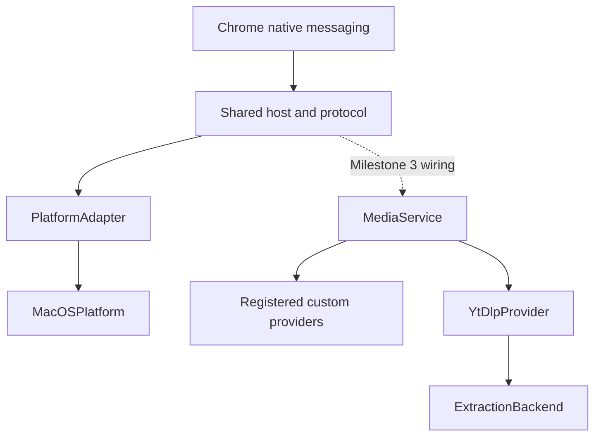

# Companion platform and provider boundaries

The companion has two independent extension points: operating-system services and media providers. macOS is the only installed platform implementation. yt-dlp metadata normalization and custom-provider selection are implemented and tested with injected extraction backends; live inspection remains disabled in the native host until milestone 3.



## Platform services

[`PlatformAdapter`](../companion/flux_companion/platforms.py) owns tool discovery, dependency probes and installation locations. The host accepts an adapter rather than choosing paths itself. The macOS installer obtains default paths from the same adapter; its shell launcher and native manifest registration remain macOS installation code.

`ProbeRunner` separates bounded version probes from discovery. Its pipe reader uses a thread instead of Unix selectors so the shared probing mechanism can also be used with Windows pipes. This runner is only for short version queries, not downloads.

A Windows implementation can supply the same platform contract without changing protocol handling or providers. It will still need an executable launcher, Chrome registry registration, dependency packaging and Windows acceptance. Job process-tree supervision, approved destinations and credential storage will need platform contracts when those features are implemented; the current adapter does not claim those services exist.

## Media providers

[`MediaService`](../companion/flux_companion/media.py) validates the source, chooses a provider and validates its normalized result. Providers implement `id`, `supports(url)` and `inspect(url)`. `supports` is a cheap local match and must not perform network requests.

Every provider returns `ProviderInspection` with two parts:

- `media`: bounded title, duration and selections described by `MediaInfo` and `MediaSelection`. Audio-only, video-only and combined tracks stay distinguishable.
- `plans`: private provider-specific handles keyed by selection ID. The service binds the inspection to its originating provider. These handles are never extension payloads; future job creation must resolve them inside the companion rather than accepting raw format IDs from Chrome.

[`YtDlpProvider`](../companion/flux_companion/ytdlp.py) translates yt-dlp metadata into this shared model. It drops extractor URLs and raw dumps, skips DRM formats and limits the result to 200 selections. This is metadata normalization, not a promise that a displayed format can already be downloaded or merged. Inspection currently accepts one item; playlists are rejected.

The provider depends on `ExtractionBackend.extract(url)`, not a platform class or subprocess API. A backend can invoke yt-dlp through a controlled child process or provide fixtures in tests. A production backend has not been enabled: it must enforce request policy, bounded extraction and cancellation first. Both yt-dlp and custom implementations must enforce the same selected route and destination checks on every network path. Initial URL validation alone does not cover DNS, redirects or nested media requests.

## Register a custom adapter

Custom code is packaged with the companion and registered explicitly in [`composition.py`](../companion/flux_companion/composition.py). There is no automatic discovery or downloaded plugin execution. An adapter can use an independent implementation while returning the same media model:

```python
from urllib.parse import urlsplit

from flux_companion.composition import media_service
from flux_companion.media import MediaInfo, MediaSelection, ProviderInspection


class ExampleProvider:
    id = "example"

    def __init__(self, client):
        self.client = client

    def supports(self, url):
        return urlsplit(url).hostname == "media.example.com"

    def inspect(self, url):
        item = self.client.inspect(url)
        selection = MediaSelection("original", "Original", "mp4", None, True, True)
        return ProviderInspection(
            MediaInfo(item.title, item.duration, (selection,)),
            {selection.id: item.private_download_handle},
        )


service = media_service(backend, custom=(ExampleProvider(client),))
review = service.inspect("https://media.example.com/watch/123")
```

`backend` and `client` are trusted dependencies supplied by the application; the example does not enable arbitrary network clients from extension messages. Registration order is precedence: custom providers are checked first, yt-dlp last. A false `supports` result or `ProviderNotApplicable` permits fallback. Other failures remain failures, avoiding hidden retries through a different provider or route. Duplicate provider IDs and invalid result/plan mappings are rejected.

The current contract covers inspection. Download execution, stale-review expiry, persistent plan ownership and cancellation will extend this boundary during the job milestones. No unused download or Windows implementations are presented as working features.

## Verification

`companion/test_boundaries.py` covers platform injection, unsupported OS rejection, bounded probes, packaged modules and ownership-preserving uninstall, provider precedence/fallback, invalid inputs/results and yt-dlp normalization. Host framing and origin checks remain covered by `companion/test_host.py`. See the [recorded acceptance results](verification-companion-02.md).
